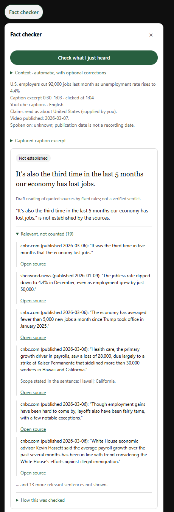
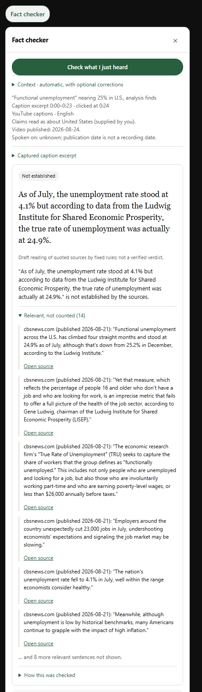
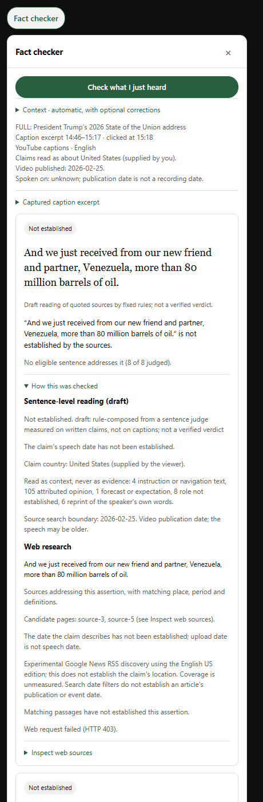

# Fact Checker

Fact Checker connects YouTube captions to a local Python claim-checking pipeline,
combining DeBERTa classifiers, ONNX inference, and evidence retrieval. Its saved
FEVER benchmark pipeline uses a SQLite-backed Wikipedia store and a memory-mapped
BM25 index built in two streaming passes.

The browser extension lets a viewer request a check and inspect supporting source
quotations and links. It remains a development prototype; the offline results
below measure individual components, not reliability on political videos.

## What a check looks like

Pause after a claim and press **Check what I just heard**. The extension reads the last
30 seconds of captions, and the local checker picks up to three check-worthy sentences.
It searches Google News for each one and reads the pages on your machine, then shows one
card per claim, newest first:

- **The badge.** "Supported" or "Contradicted" appears only when an independent source with
  a confirmed date states it. Otherwise the card says "Not established", which is the usual
  result on real speech.
- **The quotes.** Every source sentence is quoted word for word with its publisher, date and
  a link. Sentences that bear on the claim without stating it are listed under *Relevant,
  not counted* and never decide the badge.
- **How this was checked.** This section lists what was set aside and why: attributed
  opinion, forecasts, image captions, and the speaker's own words reprinted by a transcript
  or a quoting article. It also lists the searches and the pages that failed to load.

Three checks recorded on 2026-10-20. Each was rendered by the extension's own panel code
over the saved result; the video player is not shown.

| Jobs report (CBS News) | Functional unemployment (CBS News) | 2026 State of the Union |
| --- | --- | --- |
|  |  |  |
| CNBC's "It was the third time in five months that the economy lost jobs" is shown but not counted. The judge read it as stating the claim with 0.83 confidence, below its counting threshold of 0.854. That threshold was fitted on FEVER to a 95% target stated in advance. | CBS gives both of the claim's figures, 24.9% (Ludwig Institute) and 4.1%, in separate sentences. No single sentence states the claim as a whole, so it stays not established. | Six sentences from the published transcript and from articles quoting the speech are recognised as the speaker's own words and set aside. |

These cards predate support confirmation (below). With it, CNBC's sentence on the first card
is confirmed at 0.998 entailment and the claim reads Supported; the second claim is split at
its "but" and both halves are supported by CBS.

**On real videos the reading rarely commits, and when it does it is often wrong.** The
latest run covered eight videos: news segments, a press conference, a press gaggle, a
debate, a State of the Union address and a Senate hearing. It made 20 clicks and checked
51 claims. 48 were not established. Three pointed a direction:

- "Construction, we saw 11,000 jobs" was counted as supported. In the CNBC sentence it
  rested on, the 11,000 belonged to another sector.
- "We didn't do a thing when the attack took place" was counted as contradicted by an
  unrelated article.
- "The US military has never been deployed" was counted as contradicted. That is right for
  the words as captioned, but the caption cut off the speaker's "at our polls".

The sentence judge was measured on written claims (see Findings) and does not transfer
cleanly to captions. Since that measurement, reprints of the speech itself are recognised
and set aside; 67 such sentences were withheld in this run. Caption sentences that cannot
be researched on their own are listed as not checked, with the reason. These are fragments
like "Last month it was 32,000", a "he" or "they" that names no one, reported speech, and a
sentence still being spoken at the click. A click took 21 seconds at the median (6–61 s).

**Support confirmation.** The sentence judge often reads a true paraphrase as stating the
claim just below its counting band. A larger NLI model (DeBERTa-v3-large, trained on five NLI
datasets) now confirms those near misses, and only those, before they count. It never vetoes
a count, proposes one from context, or touches contradictions. Each of those variants was
tried and added wrong readings on held-out claims. The stage was chosen on development sets
and registered before a single test (`runs/checker-numbers/REGISTRATION.md`, paired replays
of the same research plans):

| Held-out set | Before: right / wrong | After: right / wrong |
| --- | --- | --- |
| 105 written claims, truth fixed before clicking | 21 / 1 | **29 / 1** |
| 61 real caption claims from 8 unseen videos (35 scorable) | 3 / 2 | **5 / 1** |

The truth labels for captions come from an automated annotator with web search, blind to the
checker's output, not from people. Coverage on real speech is still low: most claims remain
not established, usually because retrieval found no page that states them.

## Findings

The research question is whether a claim verifier's confidence knows when it was
not given the evidence it needed. The short paper ([PDF](paper/main.pdf),
[source](paper/main.tex), [where each number comes from](paper/PROVENANCE.md))
reports:

- **Calibration works.** Vector scaling fitted on a separate calibration split cuts
  expected calibration error from 0.129 to 0.031 on 2,000 held-out FEVER claims. A
  confidence band promised at 90% accuracy delivers 92.1% on 31% of them.
- **Confidence barely tracks groundedness.** When the gold evidence never reached
  the model, its mean confidence is only 0.037 lower; it still answers most of those
  claims correctly, consistent with FEVER's claim-only artifacts.
- **A retrieval-side sufficiency score does,** with AUC 0.75 against 0.59 for the
  verdict logits, but it barely predicts correctness (0.53). Used as a separate gate,
  it declines 44% of ungrounded claims against 18% of grounded ones, at a cost of 18
  points of coverage.
- **Relabelling ungrounded training rows as "not enough evidence" backfires**
  (NEI F1 falls by 0.072); dropping them instead costs nothing overall.
- **On live news,** the sentence-level judge is wrong on 10 of the 18 sentences it
  counts, yet composition rules that abstain by default point the right way on 42 of
  45 directional readings in a pre-registered batch of 142 claims (32% coverage).
- **Real captions are different.** In seven checks of political speeches, five of the
  six directional readings rested on a reprint of the speech itself (a transcript, or
  an article quoting it), and two of the three that could be scored were wrong.

The news-side claims and labels come from a single automated annotator, not people;
the real-caption truth values were supplied by the author. The paper states each
measurement's provenance and limits.

## Evaluation

These saved experiments evaluate three DeBERTa-v3-base verdict variants, confidence
calibration, and Wikipedia evidence retrieval. The test sample contains **2,000
held-out FEVER claims** from this project's partition of the released development
set. It is separate from calibration data and is not FEVER's official hidden test
benchmark. Results were extracted on September 18, 2026; experiments were not rerun.

| Measurement | Saved result | Scope and result record |
| --- | --- | --- |
| Wikipedia corpus and BM25 index | **5,416,536 pages; 292,551,543 postings** | [Recorded corpus/index metadata](results/retrieval/metrics.json) |
| Expected calibration error | **0.129 → 0.031** | Retrieved-evidence model; [vector scaling fitted on 2,000 separate calibration claims](results/calibration/metrics.json) |
| Multiclass Brier score | **0.441 → 0.374** | Same model and test sample; lower is better |
| Uncalibrated verdict accuracy | **Retrieved: 70.2%; claim-only: 58.7%; gold evidence: 87.8%** | [Three model variants on the same 2,000 claims](results/verdict/metrics.json) |
| Strict evidence recall@25 | **81.1%** | [1,350 verifiable claims](results/retrieval/metrics.json); excludes 650 insufficient-evidence claims |

The claim-only baseline measures how much can be predicted without evidence; the
gold-evidence variant provides an oracle reference for the retrieved-evidence
model. Strict recall requires a complete gold evidence group among the first 25
retrieved sentences. Calibration measures probability quality, not the truthfulness
of arbitrary video assessments.

The three small JSON files under [`results/`](results/) publish **aggregate extracts**
with exact values, denominators, source paths, and SHA-256 hashes. They exclude raw
claims, per-example predictions, datasets, and weights. The
[benchmark methods and provenance](docs/benchmark_results.md) explain the splits,
metric definitions, and reproduction limits.

## How it works

1. Play a YouTube video with available English captions and let a claim finish.
2. Open the **Fact checker** panel and select **Check what I just heard**.
3. The extension reads recent caption text and passes it to the local Python
   checker, which selects claims and searches for source material.
4. The panel displays source quotations, links, and an experimental assessment
   for the viewer to inspect.

Checks run when requested. The current workflow uses caption data; visible CC and
YouTube's transcript panel can stay closed. Caption availability and errors can
affect what is captured.

## Current status

This is a development prototype. Its reliability on real-world video claims has
not been established. Retrieval can return irrelevant or incomplete material,
and the checker can misinterpret a source. A quotation or citation alone does not
show that a claim is supported.

Some claims depend on definitions, geography, or dates that are missing from the
video. Others combine factual statements with opinion. The checker can leave
claims unresolved, and its assessments should be read alongside the cited
material. Improving those distinctions is ongoing work.

## Trying it locally

The current installation path is for **Windows with Chrome or Edge**. It requires
Python 3.12 or later, a repository-local Python environment with the
[dependencies](requirements.txt), and the local model and retrieval artifacts.
Model weights, datasets, and generated indexes are excluded from Git; cloning the
repository alone does not provide a ready-to-run checker.

The [extension setup guide](extension/youtube/SETUP.md) describes how to register
the local host and load the extension once those prerequisites are in place. It
also covers configuration and troubleshooting. Installation and artifact setup
are still developer-oriented.

## Local processing and web access

Model inference runs on the user's computer. Web research is enabled by default
and makes external requests: it sends claim-related search queries to Google News
and fetches public source pages. Queries may include nearby caption context and
country or date information. Source availability and external service limits can
affect a check.

The setup guide explains how to disable network research. Local-only checks use
an older Wikipedia corpus, which limits their usefulness for recent claims.

## Development direction

Current priorities are to:

- Retrieve sources that address the actual claim and its context.
- Distinguish relevant evidence from material that merely shares its wording.
- Handle missing context, conflicting sources, and uncertainty more clearly.
- Evaluate the complete workflow across a broader range of videos and topics.

## Repository guide

| Location | Contents |
| --- | --- |
| [extension/youtube](extension/youtube/) | Browser extension and local setup instructions |
| [src/pipeline](src/pipeline/) | Claim processing and evidence retrieval |
| [src/verdict](src/verdict/) | Models and rules for interpreting evidence |
| [scripts](scripts/) | Setup, data preparation, and evaluation tools |
| [results](results/) | Three small aggregate metric records with source-file hashes |
| [docs/benchmark_results.md](docs/benchmark_results.md) | Saved offline results, metric definitions, and artifact provenance |
| [paper](paper/) | Short paper (LaTeX source and PDF) and the provenance of its numbers |
| [tests](tests/) | Pipeline and extension tests |

For a reproducible problem, include the video URL and timestamp, the exact claim,
and what the checker displayed. Reports of irrelevant sources, missed context,
and incorrect interpretations help guide development.
